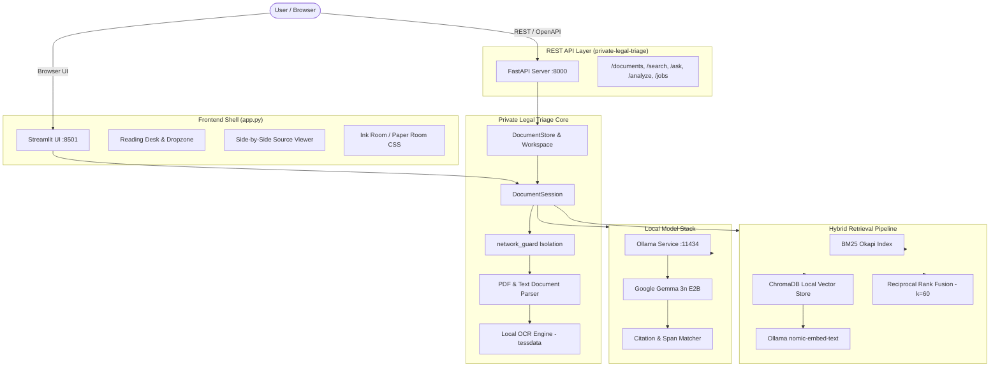

# ZeroLatency · Redline

> **Local-First, Privacy-Preserving Legal Document Triage & Reading Desk**  
> *Problem Statement 2 (PS2) · 100% Offline · Evidence-Grounded Citations · Zero Data Leakage*

[](https://www.python.org/)
[](LICENSE)
[]()
[-success.svg)]()
[](https://ollama.com/library/gemma3n)

---

## Important Legal Disclaimer

> [!IMPORTANT]
> **This tool provides a preliminary, informational reading of a document. It is not a lawyer, does not provide legal advice, and cannot determine whether any clause is valid or enforceable under applicable law.**  
> Citation verification proves solely that a quotation exists verbatim in the source text; it does not prove that the model's interpretation or legal categorization is correct. Always consult a qualified attorney before taking any consequential legal or financial action.

---

## Table of Contents

1. [Overview & Core Philosophy](#overview--core-philosophy)
2. [Key Capabilities](#key-capabilities)
3. [Architecture & System Design](#architecture--system-design)
4. [Prerequisites & Model Setup](#prerequisites--model-setup)
5. [Installation & Quickstart](#installation--quickstart)
6. [Running the Application](#running-the-application)
   - [A. Streamlit UI (Redline Reading Desk)](#a-streamlit-ui-redline-reading-desk)
   - [B. FastAPI REST Server](#b-fastapi-rest-server)
   - [C. Command Line Interface (CLI)](#c-command-line-interface-cli)
7. [Repository Layout](#repository-layout)
8. [Features & UI Tour](#features--ui-tour)
9. [Hybrid Retrieval (BM25 + ChromaDB + RRF)](#hybrid-retrieval-bm25--chromadb--rrf)
10. [Local OCR Engine](#local-ocr-engine)
11. [Privacy & Threat Model](#privacy--threat-model)
12. [Testing & Verification](#testing--verification)
13. [Configuration Reference](#configuration-reference)

---

## Overview & Core Philosophy

**ZeroLatency · Redline** is a private, local-first legal triage workspace engineered specifically for commercial and civil contracts (leases, NDAs, service agreements, employment contracts, and vendor agreements).

Unlike cloud-dependent legal AI wrappers that transmit confidential documents across the internet:
- **Zero Cloud Transmission**: Every byte of document text, vector embedding, and inference prompt remains strictly confined to your local workstation.
- **Strict Network Guard**: All network sockets are monkeypatched and monitored via `network_guard()`; any attempt to establish an outbound connection beyond `127.0.0.1:11434` (Ollama) raises an immediate `PrivacyViolation`.
- **Evidence-Grounded Citations**: The model is prohibited from presenting findings without verifiable proof. Every citation is programmatically validated against source pages with fuzzy and exact character spans before display.
- **Explicit Uncertainty & Safe Abstention**: When a document is silent or ambiguous on an issue, the system explicitly declines to guess, displaying clear escalation guidance rather than hallucinating terms.
- **Ephemeral Encrypted Storage**: Uploads are processed in temporary workspaces with optional AES-256-GCM encryption at rest and secure memory scrubbing upon closure.

---

## Key Capabilities

| Capability | Description | Implementation |
|---|---|---|
| **Local LLM Inference** | Structured extraction & conversational Q&A via Google Gemma 3n (`gemma3n:e2b` / `gemma3n:e4b`) | Ollama loopback client |
| **Hybrid Retrieval** | Sparse keyword retrieval fused with dense semantic vector search via Reciprocal Rank Fusion (RRF) | BM25 + ChromaDB + `nomic-embed-text` |
| **Verifiable Citations** | Bounding-box and snippet-level quote verification against source page text | Multi-tier fuzzy & exact matching |
| **Local OCR** | Automatic optical character recognition on scanned and image-only PDFs | PyMuPDF OCR + bundled `tessdata` |
| **Deterministic Facts** | Regex and rule-based extraction of financial amounts, dates, durations, and interest | High-precision deterministic parser |
| **Standard Checklist** | 21 key commercial clauses tracked (Indemnity, Termination, Governing Law, IP, etc.) | Atticus CUAD-calibrated patterns |
| **Contract Comparison** | Visual side-by-side contract diffing across two versions with clause shift detection | Structured diff engine |
| **Bespoke UI Shell** | Dual-theme design system: Ink Room (dark) & Paper Room (light) | Streamlit + custom CSS tokens |

---

## Architecture & System Design



---

## Prerequisites & Model Setup

### 1. Hardware & OS
- **OS**: Windows 10/11, macOS, or Linux.
- **RAM**: Minimum 8 GB (16 GB recommended).
- **VRAM / CPU**: ~2.4 GB VRAM for `gemma3n:e2b` (runs smoothly on Nvidia RTX 3050+ or Apple Silicon; runs CPU-only on modern x86/ARM processors).

### 2. Install Ollama & Pull Models
Ensure [Ollama](https://ollama.com/) is installed and running locally:

```bash
# Check Ollama status
ollama --version

# 1. Pull Gemma 3n (Local LLM for legal analysis & QA)
ollama pull gemma3n:e2b

# 2. Pull Nomic Embed Text (Local embedding model for semantic search)
ollama pull nomic-embed-text

# Verify installed models
ollama list
```

---

## Installation & Quickstart

Clone the repository and set up a Python virtual environment:

```bash
# 1. Clone repository
git clone https://github.com/ZERODAY-2026/ZeroLatency.git
cd ZeroLatency

# 2. Create and activate virtual environment
python -m venv private-legal-triage/.venv

# Windows PowerShell:
.\private-legal-triage\.venv\Scripts\Activate.ps1
# Linux / macOS:
source private-legal-triage/.venv/bin/activate

# 3. Install dependencies
pip install -r private-legal-triage/requirements.txt
pip install -r private-legal-triage/requirements-api.txt
pip install -r private-legal-triage/requirements-eval.txt
```

---

## Running the Application

### A. Streamlit UI (Redline Reading Desk)

The primary user interface is an elegant, editorial reading desk:

```powershell
# From the project root:
.\private-legal-triage\.venv\Scripts\streamlit.exe run app.py --server.headless true --server.port 8501
```
Open **[http://127.0.0.1:8501](http://127.0.0.1:8501)** in your web browser.

### B. FastAPI REST Server

If integrating with external frontends, webhooks, or automated test pipelines:

```powershell
# Run local REST server:
cd private-legal-triage
.\.venv\Scripts\uvicorn.exe src.api:app --host 127.0.0.1 --port 8000
```
- **Root Service Status**: [http://127.0.0.1:8000/](http://127.0.0.1:8000/)
- **Interactive Swagger Docs**: [http://127.0.0.1:8000/docs](http://127.0.0.1:8000/docs)
- **Health Check**: [http://127.0.0.1:8000/health](http://127.0.0.1:8000/health)

### C. Command Line Interface (CLI)

Perform batch analysis or ask targeted questions directly from the terminal:

```bash
# Analyze sample document and output summary & findings
python -m src.cli private-legal-triage/samples/rental_agreement.pdf

# Ask a specific question from the CLI
python -m src.cli private-legal-triage/samples/rental_agreement.pdf --ask "What is the penalty for late rent payments?"

# Output complete structured JSON
python -m src.cli private-legal-triage/samples/rental_agreement.pdf --json
```

---

## Repository Layout

```text
ZeroLatency/
├── app.py                         # Streamlit frontend application entry point
├── frontend.md                    # Detailed frontend specification & UI state machine
├── DESIGN.md                      # Design system specifications & CSS token registry
├── ui/                            # Streamlit UI modules
│   ├── desk.py                    # Upload dropzone, file checks, and analysis launcher
│   ├── overview.py                # Executive summary, risk scorecards, and key metrics
│   ├── findings.py                # Categorized findings list with citation badges
│   ├── source_view.py             # Side-by-side PDF/TXT viewer with quote highlighting
│   ├── ask.py                     # "Ask the Document" conversational Q&A interface
│   ├── facts.py                   # Deterministic key facts extraction table
│   ├── checklist.py               # Standard contract clause checklist
│   ├── export.py                  # Markdown & JSON report export generator
│   ├── privacy_page.py            # Real-time privacy & network containment auditor
│   ├── auth.py                    # Optional local vault lock (passphrase hashing)
│   ├── rail.py                    # Persistent left navigation sidebar
│   ├── theme.py                   # Ink Room (dark) & Paper Room (light) styles
│   └── components.py              # Reusable badges, cards, and UI widgets
├── private-legal-triage/          # Core backend package
│   ├── tessdata/                  # Bundled offline OCR language data (eng.traineddata)
│   ├── requirements.txt           # Core Python dependencies
│   ├── requirements-api.txt       # FastAPI & Uvicorn dependencies
│   ├── requirements-eval.txt      # CUAD evaluation suite dependencies
│   ├── src/                       # Backend source library
│   │   ├── config.py              # Application settings & environment configurations
│   │   ├── pipeline.py            # DocumentSession execution engine
│   │   ├── service.py             # DocumentStore multi-doc lifecycle & job manager
│   │   ├── api.py                 # FastAPI endpoints & error handlers
│   │   ├── privacy.py             # network_guard() loopback enforcer & PrivateWorkspace
│   │   ├── document_parser.py     # PDF & text extractors, page pagination
│   │   ├── ocr.py                 # PyMuPDF local OCR integration & tessdata resolver
│   │   ├── vector_store.py        # ChromaDB persistent local vector storage
│   │   ├── embedding_client.py    # Local Ollama embedding client (nomic-embed-text)
│   │   ├── retrieval.py           # HybridRetriever & Reciprocal Rank Fusion (RRF)
│   │   ├── gemma_client.py        # Ollama LLM client for Google Gemma 3n
│   │   ├── qa.py                  # Grounded question answering & citation verification
│   │   ├── comparison.py          # Contract diffing & clause change analysis
│   │   ├── highlight.py           # PDF page rendering & quote bounding-box highlighter
│   │   └── schemas.py             # Pydantic schemas (Finding, Answer, Chunk, TriageResult)
│   ├── tests/                     # 171 Unit & integration tests
│   │   ├── test_hybrid_retrieval.py # Hybrid search, vector isolation, RRF tests
│   │   ├── test_ocr.py            # Local OCR unit & end-to-end scanned PDF tests
│   │   ├── test_privacy.py        # Zero-leakage & loopback containment tests
│   │   └── integration/           # Opt-in live Gemma 3n inference tests
│   └── docs/                      # Technical specifications & evaluation reports
└── samples/                       # Synthetic test contracts & agreements
```

---

## Features & UI Tour

### 1. Reading Desk (`Desk`)
- Drag-and-drop file upload supporting `.pdf` and `.txt` files up to 50 MB.
- Live model readiness check that automatically probes Ollama and displays connection health.
- One-click demo contract loader (`rental_agreement.pdf`).
- Pre-flight text quality check with sparse-page warnings for scanned documents.

### 2. Overview & Findings
- **Executive Plain-Language Summary**: High-level synthesis of contract structure and obligations.
- **Categorized Findings**: Clauses grouped into Liabilities, Terminations, Covenants, Financials, and IP.
- **Three-Tier Verification Badges**:
  - `Verified`: The quote was located verbatim in the document on the specified page.
  - `Possible Reading`: Plausible finding where phrasing slightly differs or spans multiple sections.
  - `Unverified`: The model extracted a claim that could not be matched to the source text.
- **Confidence Ratings**: Explicit confidence scoring (`High`, `Medium`, `Low`) based on textual grounding.

### 3. "Ask the Document" (Grounded Q&A)
- Conversational querying over the active document.
- Answers cite specific pages and verbatim excerpts.
- **Safe Abstention**: If the document does not mention an issue, the tool returns `Answerable: False` with "Document is silent" and provides legal escalation guidance.

### 4. Side-by-Side Source Viewer
- Renders source PDF page images directly beside finding cards.
- Automatically highlights and scrolls to verified quotations.

### 5. Deterministic Key Facts & Checklist
- **Key Facts**: Extracts monetary amounts (Rs, $, €), deadlines, renewal periods, and interest penalties without LLM hallucination.
- **Checklist**: Audits standard contract boilerplate clauses to identify what is present and what is missing.

### 6. Document Version Comparison
- Upload two versions of a contract to inspect semantic and text changes across clauses.

---

## Hybrid Retrieval (BM25 + ChromaDB + RRF)

ZeroLatency pairs exact keyword retrieval with dense semantic vectors to achieve state-of-the-art clause recall:

1. **BM25 Lexical Search**: Captures exact legal definitions, numbered statutory references, party names, and monetary values.
2. **Dense Vector Search**: ChromaDB stores 768-dimensional local embeddings generated by `nomic-embed-text` via Ollama, capturing paraphrased terms (e.g., matching *"how do I quit the lease?"* to *"Tenant Termination Notice"*).
3. **Reciprocal Rank Fusion (RRF)**:
   $$\text{RRF Score}(d) = \sum_{m \in \{\text{bm25}, \text{vector}\}} \frac{1}{k + \text{rank}_m(d)}$$
   Fuses candidate lists ($k=60$) to surface passages that excel in both lexical precision and semantic relevance.
4. **Graceful Degradation**: If the vector store is unavailable, retrieval automatically falls back to BM25-only without disrupting document triage.

---

## Local OCR Engine

For scanned agreements, photocopies, and image-only PDFs, ZeroLatency provides 100% offline optical character recognition:
- **Zero External Binaries**: Utilizes PyMuPDF's built-in Tesseract C-engine directly through Python wheels.
- **Bundled Language Support**: Ships with [`private-legal-triage/tessdata/eng.traineddata`](file:///private-legal-triage/tessdata/eng.traineddata) (4.1 MB) inside the repository—no system package managers or drivers required.
- **Automatic Fallback**: Pages with fewer than 40 extractable characters automatically trigger local OCR rendering at 150 DPI.
- **Strict Privacy**: OCR operates strictly inside `network_guard()` with zero outbound telemetry.

---

## Privacy & Threat Model

| Threat / Risk | ZeroLatency Mitigation |
|---|---|
| **Cloud Data Leakage** | `network_guard()` monkeypatches `socket.socket`. Any non-loopback connect (`127.0.0.1`) throws an uncatchable `PrivacyViolation`. |
| **Telemetry Leakage** | ChromaDB initialized with `anonymized_telemetry=False`. Streamlit run with `gatherUsageStats=false`. |
| **Disk Forensics** | Documents stored in `PrivateWorkspace` temporary folders; unlinked and shredded on exit. Optional AES-256-GCM encryption at rest. |
| **Model Weight Privacy** | All inference executes against locally hosted weights via Ollama on localhost port 11434. |
| **Log Scrubbing** | Strict audit test (`test_no_logging_of_document_data_in_library_code`) ensures zero document text or PII is written to log files. |

Run the offline privacy auditor at any time:
```bash
python scripts/privacy_check.py
```

---

## Testing & Verification

ZeroLatency is backed by an extensive, multi-layered test suite:

```bash
# 1. Run all 171 non-live unit & integration tests
pytest private-legal-triage/tests/ -m "not live_model" -v

# 2. Run hybrid retrieval test suite
pytest private-legal-triage/tests/test_hybrid_retrieval.py -v

# 3. Run offline OCR test suite
pytest private-legal-triage/tests/test_ocr.py -v

# 4. Run strict privacy & network containment tests
pytest private-legal-triage/tests/test_privacy.py -v

# 5. Run Ruff code quality & style checks
ruff check .

# 6. Run live Gemma 3n inference tests (requires Ollama running)
$env:TRIAGE_RUN_REAL_MODEL="1"; pytest private-legal-triage/tests/integration/test_real_gemma.py -v
```

---

## Configuration Reference

All settings can be configured via environment variables or modified in [`src/config.py`](file:///private-legal-triage/src/config.py):

| Variable | Default | Purpose |
|---|---|---|
| `TRIAGE_MODEL` | `gemma3n:e2b` | Local Ollama model ID for analysis & Q&A (`gemma3n:e2b` or `gemma3n:e4b`) |
| `TRIAGE_OLLAMA_URL` | `http://127.0.0.1:11434` | Loopback URL for local Ollama service |
| `TRIAGE_EMBEDDING_MODEL` | `nomic-embed-text` | Ollama model ID for local vector embeddings |
| `TRIAGE_HYBRID_RETRIEVAL`| `1` | Enable/disable hybrid retrieval (`1` = enabled, `0` = BM25 only) |
| `TRIAGE_CHROMA_PATH` | `./data/chroma` | Persistent local directory for ChromaDB storage |
| `TRIAGE_OCR_ENABLED` | `1` | Enable/disable automatic local OCR on scanned pages |
| `TRIAGE_ENCRYPT_AT_REST` | `0` | Enable AES-256-GCM encryption for temporary workspace files |
| `TRIAGE_TIMEOUT` | `300` | Maximum request timeout in seconds for local model calls |
| `TRIAGE_NUM_CTX` | `8192` | Model context window size in tokens |
| `TRIAGE_MAX_FILE_BYTES` | `52428800` | Maximum upload file size (default: 50 MB) |
| `TRIAGE_CORS_ORIGINS` | `http://localhost:5173,...` | Allowed loopback origins for FastAPI CORS |

---

## License

This project is licensed under the MIT License. See [LICENSE](LICENSE) for details.